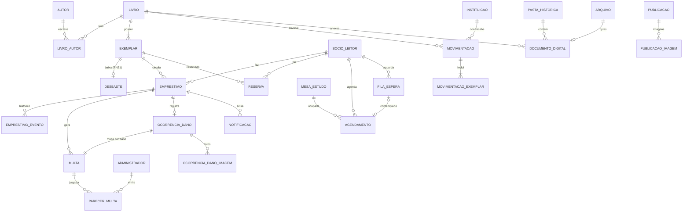

# Banco de dados — CulturaTech

Modelo relacional para **PostgreSQL 16** no **Amazon RDS**, derivado de `src/lib/types.ts`, das regras em
`src/lib/regras.ts`/`constants.ts` e do diagrama de classes (`modelo de classes/`).

| Arquivo                       | Conteúdo                                                                                                |
| ----------------------------- | ------------------------------------------------------------------------------------------------------- |
| `01_schema.sql`               | Tabelas, restrições, índices, triggers de regras de negócio e visões (schema `culturatech`)             |
| `02_dados_exemplo.sql`        | Dados de demonstração com as mesmas contas e cenários do README do app                                  |
| `03_ajuste_search_path.sql`   | Só para bancos criados antes de as funções fixarem o próprio `search_path`; rode uma vez                |
| `04_localizacao_exemplar.sql` | Só para bancos criados antes da coluna `exemplar.localizacao`; rode uma vez (pode repetir sem problema) |

> Banco novo: rode apenas `01_schema.sql` (e, se quiser os dados de demonstração, `02_dados_exemplo.sql`). Os arquivos
> `03` e `04` são ajustes para bancos já existentes; num banco novo eles são desnecessários, mas inofensivos.

## Diagrama entidade-relacionamento



## Decisões de modelagem

- **Usuários**: `administrador` e `socio_leitor` são tabelas separadas (o diagrama usa a superclasse `Usuario`),
  porque os dados e o login diferem — administrador entra pelo usuário; sócio, por CPF ou e-mail.
  Senhas são guardadas como hash **bcrypt**, gerado pelo back-end (não SHA-256 como no protótipo).
- **Obra × exemplar**: `livro` é o título; `exemplar` é o item físico com UUID (RN20) e tombamento único.
  Exemplares baixados (desbaste/doação) recebem `baixa_data`/`baixa_motivo` e nunca são apagados, para manter o histórico.
- **Localização do exemplar**: `exemplar.localizacao` (`VARCHAR(80)`, opcional) diz onde a cópia fica, por exemplo
  "Estante 3, prateleira B". Quando é nula, vale a `secao` (A–Z) da obra. É informação interna da equipe: a visão
  `vw_consulta_publica` não a expõe.
- **Arquivos**: imagens e PDFs ficam no **Amazon S3**; a tabela `arquivo` guarda só metadados e a chave do objeto
  (`chave_storage`, no formato `<pasta>/<uuid>.<extensão>`, com as pastas `mural`, `acervo`, `documentos`, `socios` e
  `danos`). Banco relacional não é bom lugar para binários grandes.
- **Listas do front-end viraram tabelas**: `autorIds` → `livro_autor` (com ordem — RN19), `historico` do empréstimo →
  `emprestimo_evento`, `pareceres` → `parecer_multa`, `tombamentos` → `movimentacao_exemplar`, `imagemIds` → tabelas de imagem.
- **Backups**: a tela de backups do protótipo é substituída pelos backups automáticos e snapshots do RDS.
- **Domínios** (status, categorias, turnos) usam `VARCHAR + CHECK` com os mesmos valores do `types.ts`,
  então o back-end pode trafegar os valores sem conversão.

### Regras garantidas pelo próprio banco

| Regra                                                  | Como                                                            |
| ------------------------------------------------------ | --------------------------------------------------------------- |
| RN01 — até 3 itens (empréstimos + reservas)            | trigger `tg_validar_emprestimo` / `tg_validar_reserva`          |
| RN04 — raro, cordel e exemplar único não saem          | triggers acima                                                  |
| RN05 — um agendamento por sócio por dia                | índice único parcial `ux_agendamento_socio_dia`                 |
| RN08 — multa em aberto ou atraso bloqueia              | função `fn_socio_bloqueado` nos triggers                        |
| RN17 — até 3 renovações                                | `CHECK (renovacoes BETWEEN 0 AND 3)`                            |
| RN22 — seção de A a Z                                  | `CHECK (secao ~ '^[A-Z]$')`                                     |
| RN26 — pessoa física recebe 1 doação                   | trigger `tg_validar_doacao`                                     |
| RN30 — mascarar status internos                        | visão `vw_consulta_publica`                                     |
| RN31 — desbaste só de ocioso/danificado, com relatório | `CHECK` em `desbaste`                                           |
| Um empréstimo/reserva ativo por exemplar               | índices únicos parciais                                         |
| Uma mesa por turno                                     | `ux_agendamento_mesa_turno`                                     |
| Aviso de e-mail enviado uma vez por prazo              | `UNIQUE (emprestimo_id, tipo, referencia)`                      |
| Status do exemplar acompanha a circulação              | triggers `tg_sincronizar_emprestimo` / `tg_sincronizar_reserva` |

Cálculos dependentes da data (multa de R$ 1,00/dia, expiração de reservas e da fila, envio de e-mails) continuam na
rotina diária do back-end; a visão `vw_situacao_socio` já entrega o débito corrente de cada sócio.

## Como criar no Amazon RDS

1. **Console AWS → RDS → Criar banco de dados**
   - Método: _Criação padrão_ · Mecanismo: **PostgreSQL 16**
   - Modelo: **Nível gratuito** (db.t3.micro / db.t4g.micro, 20 GB gp3)
   - Identificador: `culturatech-db` · usuário mestre: `postgres` · defina uma senha forte
   - Nome do banco inicial (em _Configuração adicional_): `culturatech`
   - Backups automáticos: manter ligado (7 dias)
2. **Conectividade**
   - Para testes da equipe: _Acesso público = Sim_ e, no **Security Group**, liberar a porta **5432** apenas para os
     IPs de vocês (`Meu IP`). Nunca libere `0.0.0.0/0`.
   - Em produção, o ideal é acesso público = Não, com só o back-end (na mesma VPC) acessando o banco.
3. Aguarde o status **Disponível** e copie o **endpoint** (ex.: `culturatech-db.xxxx.us-east-1.rds.amazonaws.com`).
4. **Execute os scripts** (pelo `psql`, DBeaver, pgAdmin ou Azure Data Studio com extensão PostgreSQL):

   ```bash
   psql "host=<endpoint> port=5432 dbname=culturatech user=postgres sslmode=require" -f 01_schema.sql
   psql "host=<endpoint> port=5432 dbname=culturatech user=postgres sslmode=require" -f 02_dados_exemplo.sql
   ```

   Se o banco já existia de antes, rode também os ajustes que faltarem: `03_ajuste_search_path.sql` e
   `04_localizacao_exemplar.sql`.

5. **Crie um usuário próprio para a aplicação** (não use o `postgres` no back-end):

   ```sql
   CREATE ROLE app_culturatech LOGIN PASSWORD '<senha forte>';
   GRANT USAGE ON SCHEMA culturatech TO app_culturatech;
   GRANT SELECT, INSERT, UPDATE, DELETE ON ALL TABLES IN SCHEMA culturatech TO app_culturatech;
   GRANT USAGE ON ALL SEQUENCES IN SCHEMA culturatech TO app_culturatech;
   ALTER ROLE app_culturatech SET search_path = culturatech, public;
   ```

6. Teste rápido:

   ```sql
   SET search_path TO culturatech;
   SELECT nome, bloqueado, total_multas, multa_corrente FROM vw_situacao_socio;
   ```

> ⚠️ Custos: fora do nível gratuito, uma instância parada ainda cobra armazenamento e o RDS religa sozinho após 7 dias
> parado. Apague a instância (ou crie um snapshot) quando terminar o semestre.

## Observação

O front-end (React) não acessa o banco diretamente — e não deve: navegador nunca conecta no RDS. Quem usa estas tabelas
é a API em [`server/`](../server/README.md), que cobre login e cadastro, acervo, circulação, sócios, repositório
digital e mural. Mesas de estudo, doações, notificações e backups ainda ficam no navegador; as tabelas correspondentes
existem aqui, mas ainda não têm rotas na API.
