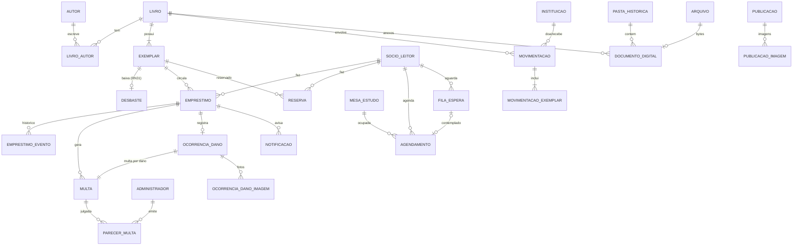

# Banco de dados — CulturaTech

Modelo relacional para **PostgreSQL 17** no **Neon**, derivado de `src/lib/types.ts`, das regras em
`src/lib/regras.ts`/`constants.ts` e do diagrama de classes (`modelo de classes/`).

| Arquivo                | Conteúdo                                                                                    |
| ---------------------- | ------------------------------------------------------------------------------------------- |
| `01_schema.sql`        | Tabelas, restrições, índices, triggers de regras de negócio e visões (schema `culturatech`) |
| `02_dados_exemplo.sql` | Dados de demonstração com as mesmas contas e cenários do README do app                      |
| `modelo_dados.png`     | Diagrama com todas as tabelas, colunas, tipos e chaves, gerado a partir de `01_schema.sql`  |

> Rode os dois em um banco vazio, nessa ordem. O `02` é opcional fora da demonstração: ele cria a conta `admin` com a
> senha `admin123`.
>
> Os PDFs de exemplo do repositório não cabem num `.sql` (os bytes ficam no bucket): depois do `02`, com a API no ar, rode
> `npm run dados-pdf` em `server/`.

## Diagrama entidade-relacionamento

O modelo completo, com as colunas, os tipos e as chaves de cada tabela, está em [`modelo_dados.png`](modelo_dados.png):

Resumo das relações:

## Decisões de modelagem

- **Usuários**: `administrador` e `socio_leitor` são tabelas separadas (o diagrama usa a superclasse `Usuario`),
  porque os dados e o login diferem — administrador entra pelo usuário; sócio, por CPF ou e-mail.
  Senhas são guardadas como hash **bcrypt**, gerado pelo back-end (não SHA-256 como no protótipo).
- **Obra × exemplar**: `livro` é o título; `exemplar` é o item físico com UUID (RN20) e tombamento único.
  Exemplares baixados (desbaste/doação) recebem `baixa_data`/`baixa_motivo` e nunca são apagados, para manter o histórico.
- **Localização do exemplar**: `exemplar.localizacao` (`VARCHAR(80)`, opcional) diz onde a cópia fica, por exemplo
  "Estante 3, prateleira B". Quando é nula, vale a `secao` (A–Z) da obra. É informação interna da equipe: a visão
  `vw_consulta_publica` não a expõe.
- **Espaço Kids (US29)**: `mesa_estudo.espaco` separa as mesas de `estudo` e `kids`. A criança de até 11 anos não tem
  cadastro: quando o agendamento ou a entrada na fila é para ela, `crianca_nome`, `crianca_cpf` e `crianca_nascimento`
  ficam preenchidos, `socio_id` é o sócio responsável e a fila dessa entrada é a do Espaço Kids. A RN05 vale para cada
  criança, pelo CPF (`ux_agendamento_crianca_dia`). `socio_leitor.data_nascimento` confere os 12 anos da conta própria
  e os 18 anos de quem é responsável no Espaço Kids; é nula em cadastros migrados, que não podem ser responsáveis até a
  data ser informada. Na anonimização do responsável, a data dele é apagada, o nome da criança vira um código
  e o CPF e o nascimento dela ficam nulos.
- **Confirmação de uso (US30)**: `agendamento.uso_confirmado_em` registra quando o funcionário confirmou que o espaço
  está em uso. Sem a confirmação em até 15 minutos do início do turno (ou do agendamento, se feito depois), o
  agendamento passa a `nao_compareceu` e a vaga vai para o primeiro da fila. Quando o uso de uma mesa Kids é confirmado,
  quem aguardava na fila daquele turno do Espaço Kids sai dela com o status `retirada`.
- **Arquivos**: imagens e PDFs ficam em um bucket compatível com S3 (**Neon Object Storage**); a tabela `arquivo` guarda só metadados e a chave do objeto
  (`chave_storage`, no formato `<pasta>/<uuid>.<extensão>`, com as pastas `mural`, `acervo`, `documentos`, `socios` e
  `danos`). Banco relacional não é bom lugar para binários grandes.
- **Listas do front-end viraram tabelas**: `autorIds` → `livro_autor` (com ordem — RN19), `historico` do empréstimo →
  `emprestimo_evento`, `pareceres` → `parecer_multa`, `tombamentos` → `movimentacao_exemplar`, `imagemIds` → tabelas de imagem.
- **Backups**: a tela de backups do protótipo guarda só cópias do navegador. Para copiar o banco, use `pg_dump`.
- **Domínios** (status, categorias, turnos) usam `VARCHAR + CHECK` com os mesmos valores do `types.ts`,
  então o back-end pode trafegar os valores sem conversão.

### Regras garantidas pelo próprio banco

| Regra                                                  | Como                                                            |
| ------------------------------------------------------ | --------------------------------------------------------------- |
| RN01 — até 3 itens (empréstimos + reservas)            | trigger `tg_validar_emprestimo` / `tg_validar_reserva`          |
| RN04 — raro, cordel e exemplar único não saem          | triggers acima                                                  |
| RN05 — um agendamento próprio por sócio por dia        | índice único parcial `ux_agendamento_socio_dia`                 |
| RN05 no Espaço Kids — um turno por dia por criança     | índice único parcial `ux_agendamento_crianca_dia` (pelo CPF)     |
| RN08 — multa em aberto ou atraso bloqueia              | função `fn_socio_bloqueado` nos triggers                        |
| RN17 — até 3 renovações                                | `CHECK (renovacoes BETWEEN 0 AND 3)`                            |
| RN22 — seção de A a Z                                  | `CHECK (secao ~ '^[A-Z]$')`                                     |
| RN26 — pessoa física recebe 1 doação                   | trigger `tg_validar_doacao`                                     |
| RN30 — mascarar status internos                        | visão `vw_consulta_publica`                                     |
| RN31 — desbaste só de ocioso/danificado, com relatório | `CHECK` em `desbaste`                                           |
| Um empréstimo/reserva ativo por exemplar               | índices únicos parciais                                         |
| Uma mesa por turno                                     | `ux_agendamento_mesa_turno`                                     |
| Aviso de e-mail enviado uma vez por prazo              | `UNIQUE (emprestimo_id, tipo, referencia)`                      |
| Status do exemplar acompanha a circulação              | triggers `tg_sincronizar_emprestimo` / `tg_sincronizar_reserva` |

Cálculos dependentes da data (multa de R$ 1,00/dia, expiração de reservas e da fila, envio de e-mails) continuam na
rotina diária do back-end; a visão `vw_situacao_socio` já entrega o débito corrente de cada sócio.

## Manual: banco e arquivos em produção (Neon)

O projeto usa o **Neon** (plano Free) para o PostgreSQL e para o armazenamento de arquivos. Quem for rodar o código precisa
de uma conta própria e de um `server/.env` (o arquivo não vai para o git; o modelo é `server/.env.example`).

**Banco.** Em um banco vazio, rode `01_schema.sql` e depois `02_dados_exemplo.sql` (opcional: cria a conta `admin` com a
senha `admin123` e os cenários de demonstração). Os dois são independentes de provedor; funcionam em qualquer PostgreSQL
16 ou superior com a extensão `pgcrypto`, que o Neon já oferece.

**O que preencher no `server/.env`:**

| Variável | O que é |
| --- | --- |
| `PGHOST`, `PGDATABASE`, `PGUSER`, `PGPASSWORD` | dados da conexão **direta** do Neon (em **Connect**, com "Connection pooling" desligado) |
| `DB_SSL` | `require` no Neon; `disable` em um PostgreSQL local |
| `JWT_SECRET` | segredo longo e aleatório (mínimo de 32 caracteres); o comando para gerar está no `.env.example` |
| `ARMAZENAMENTO` | `s3` para o bucket do Neon ou `disco` para a pasta `server/uploads` |
| `S3_BUCKET`, `S3_REGIAO`, `S3_ENDPOINT` | nome do bucket, `AWS_REGION` e `AWS_ENDPOINT_URL_S3` (em **Connect > Storage > Parameters only**) |
| `AWS_ACCESS_KEY_ID`, `AWS_SECRET_ACCESS_KEY` | chaves do bucket, na mesma tela; o nome `AWS_*` é só convenção do SDK |
| `FUSO_HORARIO` | opcional; fuso dos turnos das mesas (padrão `America/Maceio`) |

**Pontos de atenção:**

- **Conexão direta, não "pooled".** O host não pode ter `-pooler`: a API define o `search_path` ao conectar, e os scripts de
  schema também devem usar a conexão direta.
- **O armazenamento de arquivos (Object storage) precisa ser ligado na criação do projeto**, em **Services**, e só existe em algumas
  regiões (por exemplo, AWS US East N. Virginia). O bucket deve ficar `private`: quem entrega os arquivos é a API, que
  confere a permissão.
- **Hibernação.** No plano Free o banco hiberna depois de 5 minutos sem uso, e a primeira requisição seguinte demora um
  pouco mais. Os limites do Free são por projeto: 1 GB de banco, 5 GB de arquivos, 100 CU-horas de processamento por mês
  e 5 GB de transferência.
- **Arquivos de exemplo.** Depois do `02`, com a API no ar, `npm run dados-pdf` (em `server/`) envia os PDFs de exemplo.
- **Conferir a configuração.** `npm run testar-s3` testa só o bucket; `/api/saude` testa o banco. Não rode as outras suítes
  `npm run testar-*` contra o banco de produção: elas gravam dados de teste. Para elas, use um PostgreSQL local, recarregado
  a cada rodada.
- **Segredos.** Nunca coloque senha, chaves ou a URL de conexão em arquivos versionados. Se uma senha vazar, troque-a em
  **Settings > Roles** do Neon e atualize o `.env`.
- **Cópia do banco.** Os backups da tela do site guardam só dados do navegador; para copiar o banco, use `pg_dump`.

## Observação

O front-end (React) não acessa o banco diretamente — e não deve: navegador nunca conecta no banco. Quem usa estas tabelas
é a API em [`server/`](../server/README.md), que cobre login e cadastro, acervo, circulação, sócios, repositório
digital, mural, mesas de estudo e parcerias. Notificações e backups ainda ficam no navegador; a tabela `notificacao`
existe aqui, mas ainda não tem rotas na API.
